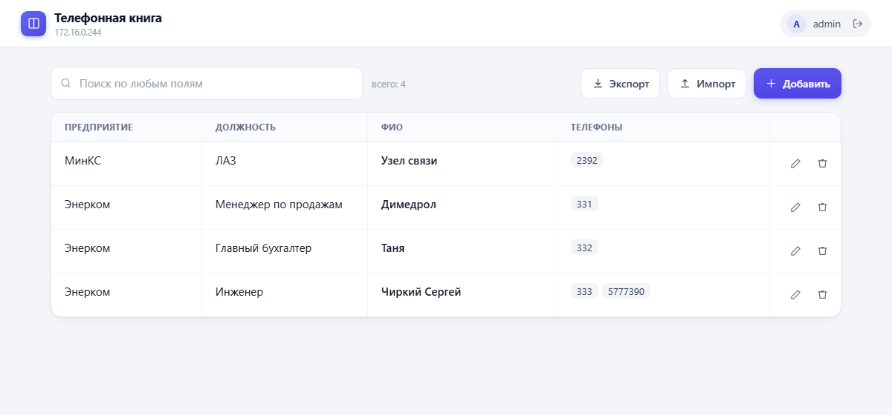
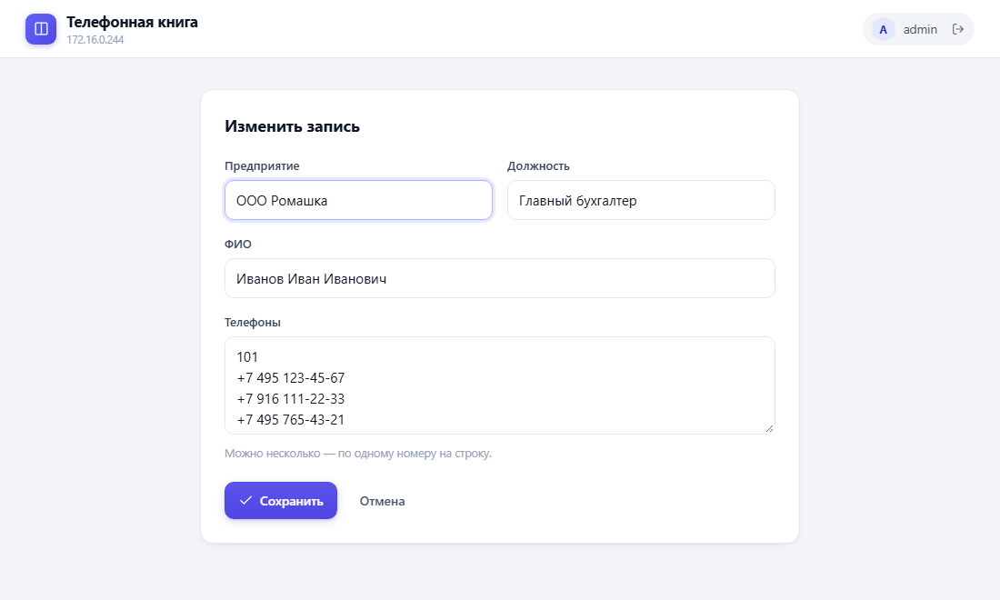

# ldap-phonebook

Телефонная книга на OpenLDAP для SIP-телефонов (**Yealink**, **Fanvil**) и
простой веб-интерфейс для персонала: четыре поля, добавление, правка, удаление,
импорт и экспорт CSV.

Телефоны читают каталог напрямую, поэтому справочник в трубке и в браузере —
это одни и те же данные. Никакой синхронизации: добавили человека в вебе —
он сразу виден на телефоне.



## Возможности

- **Простой интерфейс.** Только то, что нужно: предприятие, должность, ФИО,
  телефоны. Никаких LDAP-атрибутов и схем на экране.
- **Единый источник данных.** Телефоны ходят в LDAP сами, копий нет.
- **Две роли.** `admin` — полный доступ, `book` — только чтение (его используют
  телефоны и те, кому нужно просто посмотреть).
- **Анонимный доступ закрыт.** Без логина каталог не читается вообще.
- **CSV.** Экспорт в файл, открывающийся в Excel (UTF-8 с BOM, `;`), и импорт
  из UTF-8 или Windows-1251, с обновлением существующих записей по ФИО.
- **Установка одной командой** на чистый Debian/Ubuntu, идемпотентно.
- **Без Docker.** Только пакеты из репозитория дистрибутива и один venv.



## Быстрый старт

```bash
curl -fsSLO https://github.com/YOUR_GITHUB_USER/ldap-phonebook/releases/latest/download/ldap-phonebook-1.0.0.tar.gz
tar -xzf ldap-phonebook-1.0.0.tar.gz
cd ldap-phonebook-1.0.0

sudo ./install.sh            # спросит подтверждение и сделает всё сам
```

Скрипт поставит OpenLDAP, создаст каталог и учётные записи, поднимет
веб-интерфейс на `http://<IP>:8500/` и напечатает логины с паролями.
Они же сохраняются в `/root/ldap-phonebook-credentials.txt`.

Свои параметры:

```bash
sudo ./install.sh \
  --base-dn dc=acme,dc=ru \
  --domain acme.ru \
  --port 8500 \
  --import people.csv
```

Полный список ключей — `./install.sh --help`, подробности —
[docs/INSTALL.md](docs/INSTALL.md).

## Что устанавливается

| Что | Куда |
|---|---|
| Приложение | `/opt/ldap-phonebook` (venv внутри) |
| Настройки | `/etc/ldap-phonebook/` |
| Служба | `ldap-phonebook.service` |
| Каталог | OpenLDAP, база `ou=people,<base-dn>` |
| Логины и пароли | `/root/ldap-phonebook-credentials.txt` |

Требования: Debian 12 / Ubuntu 22.04 или новее, systemd, root, ~200 МБ на диске.
Python, OpenLDAP и зависимости ставятся из репозитория дистрибутива.

## Как это выглядит в каталоге

| Поле интерфейса | Атрибут LDAP |
|---|---|
| Предприятие | `o` |
| Должность | `title` |
| ФИО | `cn` (плюс `sn`, `givenName`, `displayName` — вычисляются) |
| Телефоны | `telephoneNumber`, многозначный |

DN записи — латиницей: `uid=ivanov-ii,ou=people,dc=acme,dc=ru`. Поэтому ФИО
можно менять свободно, не ломая ссылки и выгрузки. Отдел, если понадобится,
кладётся в `ou` и `departmentNumber` — стандартные атрибуты `inetOrgPerson`,
расширять схему не нужно.

## Телефоны

Раздел [docs/PHONES.md](docs/PHONES.md) — пошаговая настройка Yealink и Fanvil:
что нажимать в веб-интерфейсе телефона, какие значения вписывать, как проверить
и что делать, когда «не работает». Там же автопровижининг для парка аппаратов.

Коротко: адрес сервера, база `ou=people,<base-dn>`, логин `cn=book,<base-dn>`
и его пароль, фильтры по имени и номеру.

## CSV

Экспорт — кнопка в интерфейсе, файл с колонками
`Предприятие;Должность;ФИО;Телефоны`.

Импорт — тоже из интерфейса (файл или вставленный текст), совпадение ищется по
ФИО: существующая запись обновляется, новая добавляется. На сервере то же самое:

```bash
/opt/ldap-phonebook/.venv/bin/python /opt/ldap-phonebook/import_phonebook.py \
    --csv people.csv --dry-run           # только показать, что будет сделано
/opt/ldap-phonebook/.venv/bin/python /opt/ldap-phonebook/import_phonebook.py \
    --csv people.csv                     # загрузить
/opt/ldap-phonebook/.venv/bin/python /opt/ldap-phonebook/import_phonebook.py \
    --csv people.csv --update            # обновить существующие записи
```

Заголовки понимаются по-русски и по-английски: `фио`, `отдел`, `должность`,
`предприятие`, `внутренний`, `рабочий`, `мобильный`, `домашний`, `fax`.
Образец — [examples/phonebook-demo.csv](examples/phonebook-demo.csv).

## Настройка и обслуживание

```bash
systemctl status ldap-phonebook        # состояние
journalctl -u ldap-phonebook -f        # логи
systemctl restart ldap-phonebook       # после правки настроек
vim /etc/ldap-phonebook/ldap-phonebook.env
```

Резервная копия каталога:

```bash
slapcat -n 1 > backup-$(date +%F).ldif
```

Тесты (создают и удаляют одну запись «Smoke Test»):

```bash
sudo PB_ADMIN_PW='...' PB_READ_PW='...' PB_BASE_DN='dc=acme,dc=ru' bash tests/smoke.sh
```

## Безопасность

- Каталог **не отдаёт данные анонимно**: без логина не читается ничего.
- Телефоны и посетители используют учётную запись только для чтения — испортить
  справочник с телефона нельзя.
- Пароли передаются в каталог по HTTP/plain LDAP. Внутри локальной сети это
  обычная практика; если сервер доступен извне, поставьте TLS-прокси (nginx,
  Caddy) и переведите каталог на LDAPS.
- Пароль администратора каталога = пароль веб-интерфейса. Если даёте интерфейс
  персоналу, заведите отдельную учётную запись с правом записи только в
  `ou=people` — как это сделать, описано в [docs/INSTALL.md](docs/INSTALL.md).

## Удаление

```bash
sudo ./uninstall.sh                 # убрать интерфейс, каталог оставить
sudo ./uninstall.sh --purge-ldap    # удалить и данные каталога (необратимо)
```

## Структура репозитория

```
install.sh              установка
uninstall.sh            удаление
app/app.py              веб-интерфейс (stdlib + ldap3, один файл)
app/import_phonebook.py импорт CSV
systemd/                шаблон службы
config/                 пример файла настроек
docs/                   INSTALL.md, PHONES.md
tests/smoke.sh          сквозные проверки
packaging/build-dist.sh сборка tarball
.github/workflows/ci.yml  проверки и релиз
```

## Разработка

Проверки локально (нужен bash):

```bash
bash -n install.sh uninstall.sh tests/smoke.sh packaging/build-dist.sh
python3 -m py_compile app/app.py app/import_phonebook.py
bash packaging/build-dist.sh          # dist/ldap-phonebook-<version>.tar.gz
```

Публикация на GitHub (репозиторий, релиз, CI) — [docs/PUBLISHING.md](docs/PUBLISHING.md).

Публикация релиза: поднять версию в `VERSION` и `CHANGELOG.md`, поставить тег
`v1.0.0` и запушить — GitHub Actions соберёт tarball и приложит его к релизу.

## Лицензия

MIT — см. [LICENSE](LICENSE).
